

<h1 align="center">Ok, Claude</h1>

Desktop planner with an AI assistant.

  <kbd>&nbsp;&nbsp; Tauri&nbsp;&nbsp;</kbd> &nbsp;<kbd>&nbsp;&nbsp; Rust&nbsp;&nbsp;</kbd> &nbsp;<kbd>&nbsp;&nbsp; React&nbsp;&nbsp;</kbd> &nbsp;<kbd>&nbsp;&nbsp; TypeScript&nbsp;&nbsp;</kbd> &nbsp;<kbd>&nbsp;&nbsp; SQLite&nbsp;&nbsp;</kbd> &nbsp;<kbd>&nbsp;&nbsp; Claude API&nbsp;&nbsp;</kbd>

 &nbsp; 

> Work in progress. The source code is private.

<table>
<tr>
<td align="center" width="33%"><b>333</b> commits in 6 days</td><td align="center" width="33%"><b>1,031</b> passing tests</td><td align="center" width="33%"><b>Rust + React</b> Tauri 2 and SQLite</td>
</tr>
</table>

### Overview

Ok, Claude is a personal agenda for Windows desktop with an assistant that answers to voice or text. It brings together tasks in a Board and a priority Matrix, a calendar synced with Google, a daily schedule with weather, focus sessions, an end-of-day review, a people directory with birthdays, reminders and a long-term memory. The assistant works on the same data: it creates a task, books an event, opens a folder, does a calculation or searches the web.

The app is designed for one user on one computer. It lives in the system tray, listens for the wake phrase "OK Claude" or opens its pop-up with a global shortcut, and works offline. Only the AI, Google and weather need a network. Data lives in a local SQLite database, with no server and no account.

The code is private. This text describes what the product does and how it was designed, drawn from the project documentation, and the project is under active development. Each screen and module below carries the status recorded in the documents.

### How it works

A day of use:

1. The app starts in the tray when Windows boots and begins listening for the wake phrase.
2. In the morning, the Today screen shows the day summary, the weather and the "Your day" schedule block, built from tasks, events and routine.
3. The user says "OK Claude, remind me at 2 pm to research X". The pop-up opens, shows the transcript while the user speaks and creates the reminder, with an Undo button in its footer.
4. On the Board, a card is dragged to another column. A toast offers Undo, and Ctrl+Z also reverts the action.
5. When a Focus block starts, the remaining time shows in the tray. Ideas that come up during the block go to "Noted for later" and are sorted in a triage at the end.
6. At 2 pm the reminder rings with a Windows notification and a pop-up with OK and Snooze.
7. In the evening, the Review closes the day: what was planned, what was done and what moves to tomorrow.

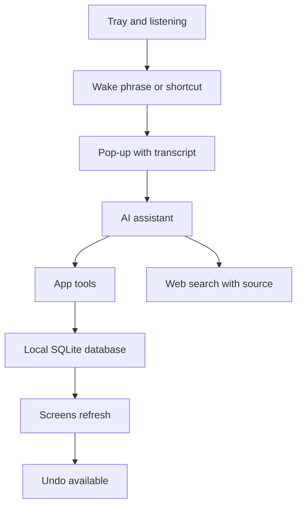

### Screens and modules in detail

Progress below reflects the project documentation as of November 2026.

#### Today (Dashboard)
Day summary, next appointment with a meeting link taken from Google, and weather. The AI-written summary is stored per day, with a button to ask for a new one, within the spending cap. Status: in progress.

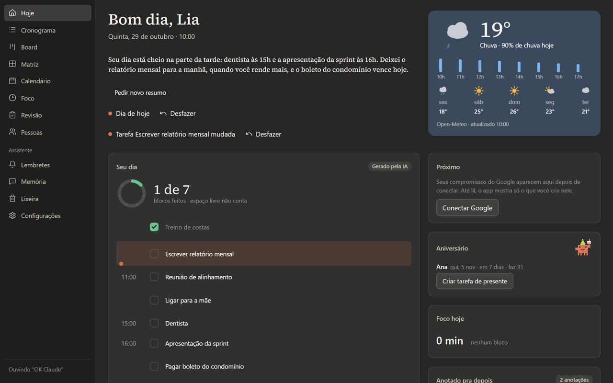 Today screen: the AI-written day summary, plan blocks, weather, birthday and the day focus.

#### Schedule
Full-screen daily plan with routine, tasks, events and weather: outdoor activities land in the sunny hours. Without the AI, the day is built from the matrix and the events alone. Screen status: done. Dragging blocks and the AI-planned week belong to v2.

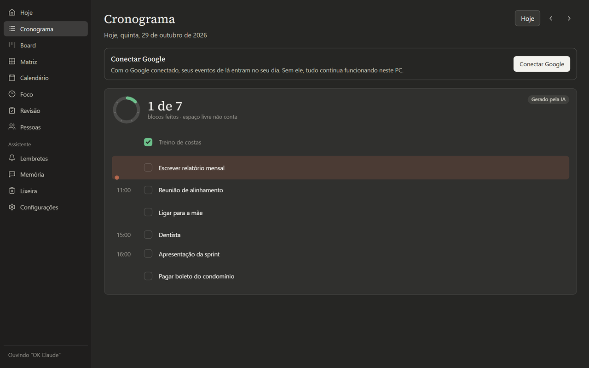 AI-generated schedule for the day, with times, events, tasks and block progress.

#### Board (Kanban)
Columns, cards with checklist, importance and first step, filters, drag by mouse or keyboard. Dragging to the Done column completes the task. Birthday cards are created automatically. Status: done.

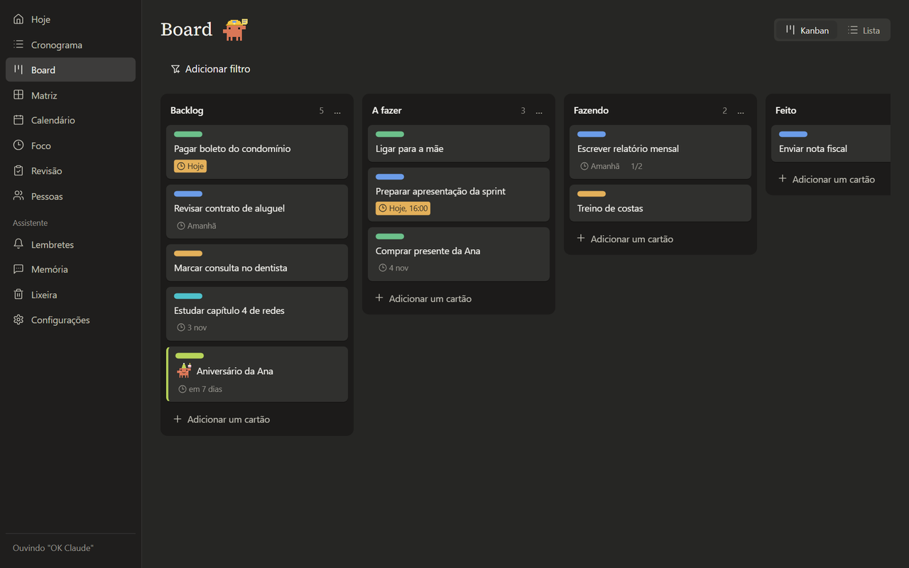 Kanban board with its four columns, colored areas, due dates and the birthday card.

#### Matrix
Tasks by urgency and importance. Status: done.

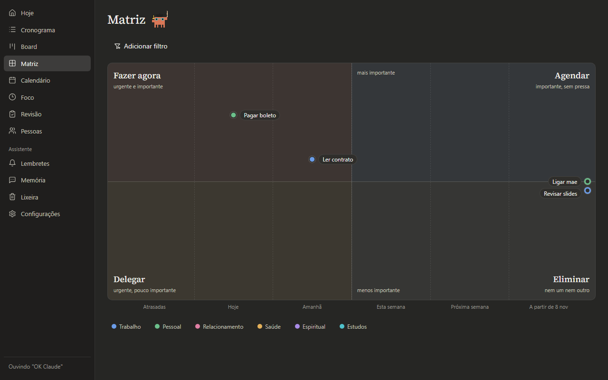 Priority matrix: importance against due date, four quadrants, areas by color.

#### Calendar
Day, Week, Month and Agenda views, Google sync every 30 seconds, an offline write queue with a "pending" badge and a dialog to disconnect the account. The app never deletes an event on Google: deleting here marks it as ignored and sends it to the Trash. Views: done. Week, detail and event form: in progress.

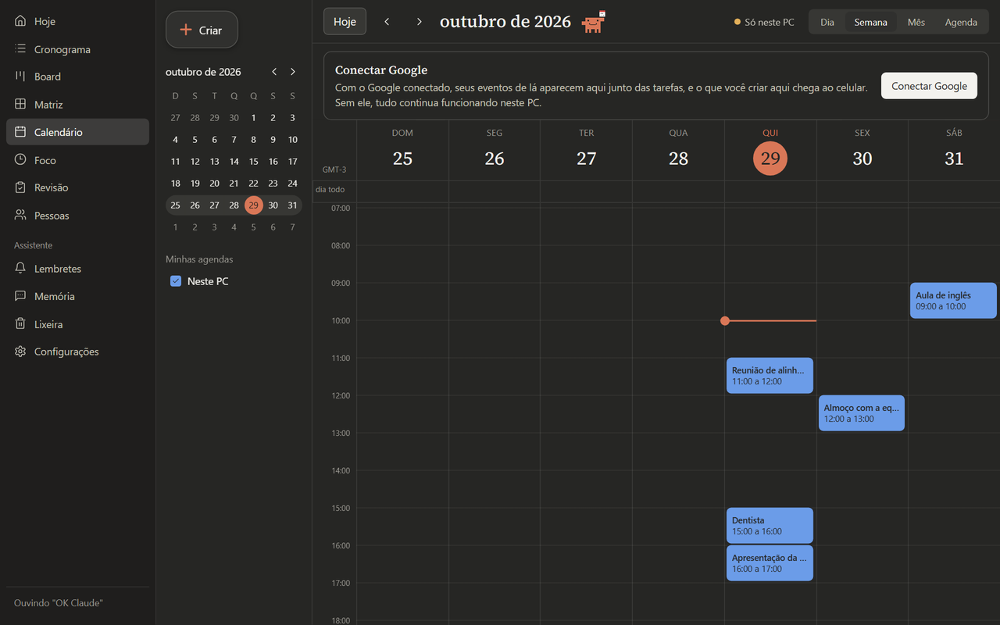 Calendar in week view, with the side mini-month, the calendar list and the day events.

#### Focus and triage
Blocks with short and long breaks, time in the tray and window title, a beep and a notification at the end. Focus: done. Triage: in progress.

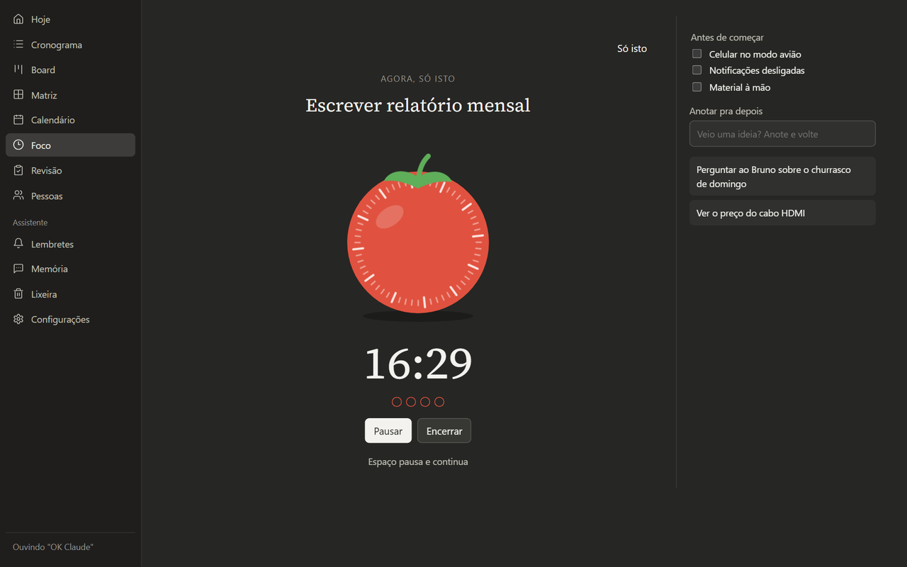 A focus session running on a task, with the timer, the pre-start checklist and the notes parked for later.

#### Review
Closes the day and invites the user through Windows at the end of the dinner routine. Status: done.

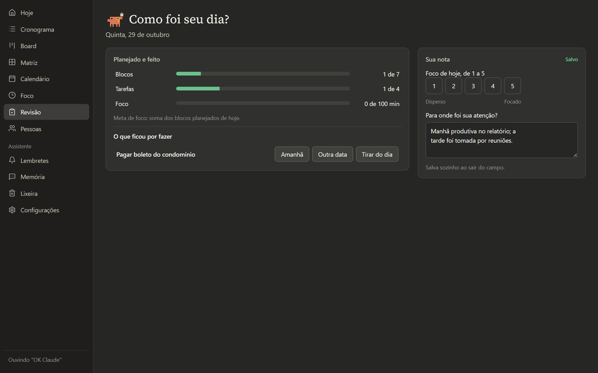 Day review: planned versus done, what was left and the owner focus note.

#### People
Directory with birthdays and preferences. Status: done.

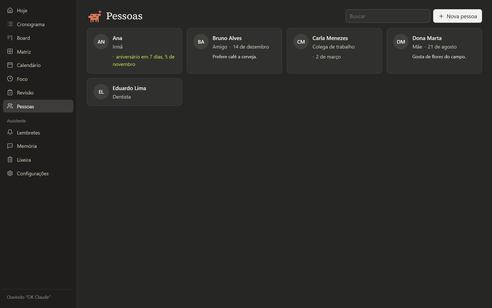 People list with relation, birthday and notes; the upcoming birthday is highlighted.

#### Reminders
Core, firing job, Windows notification and a pop-up list with OK and Snooze exist in the code. Status: in progress.

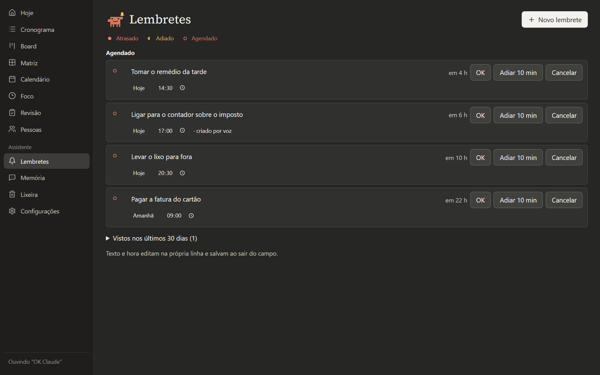 Scheduled reminders, each with OK, Snooze 10 min and Cancel, and where it came from (screen or voice).

#### Memory
Pages written by the AI, with pin, forget, a 1 GB limit and keyword search. The core and tables exist. Status: in progress. Semantic search with local embeddings belongs to v2.

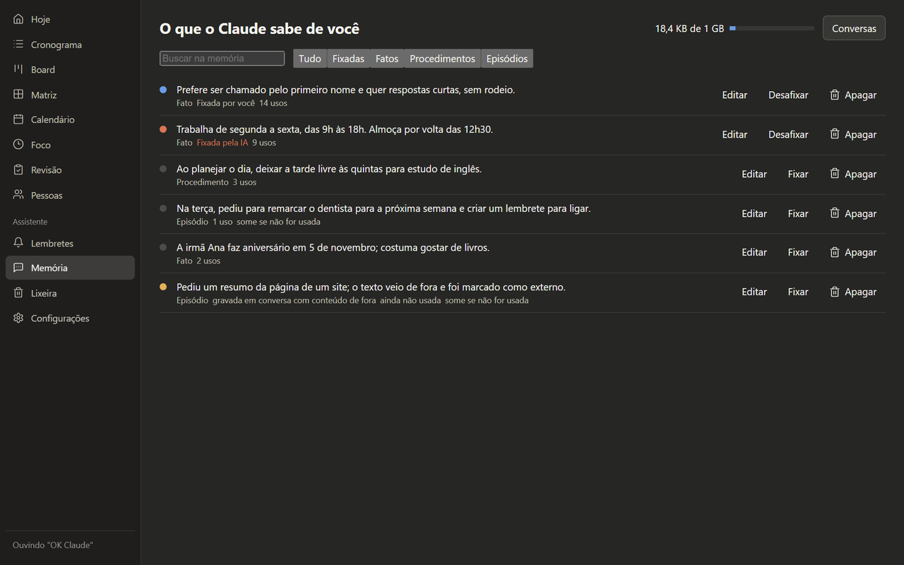 Assistant memory: facts, procedures and episodes, with pin, edit, delete and the usage meter.

#### Trash
Soft delete in every module, restore and automatic purge after 30 days. Status: in progress.

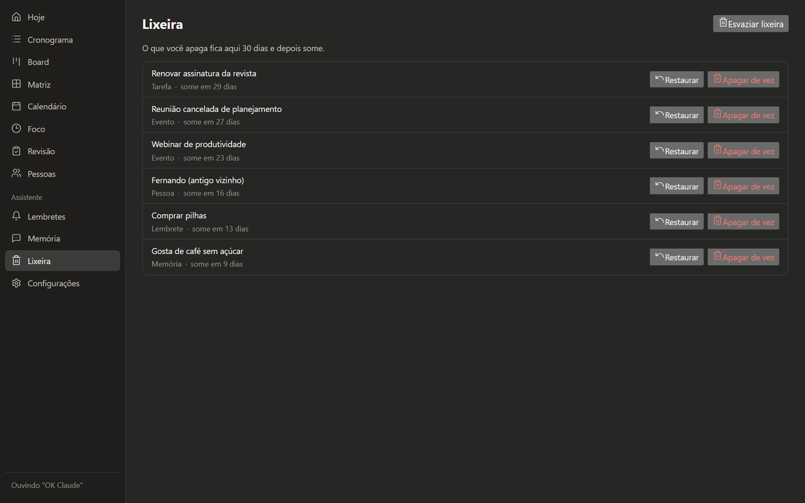 Trash with 30-day restore: deleted tasks, events, people, reminders and memory pages.

#### Settings
API key, city, Google, shortcut, start with Windows, backup restore and a first-use walkthrough. Status: in progress.

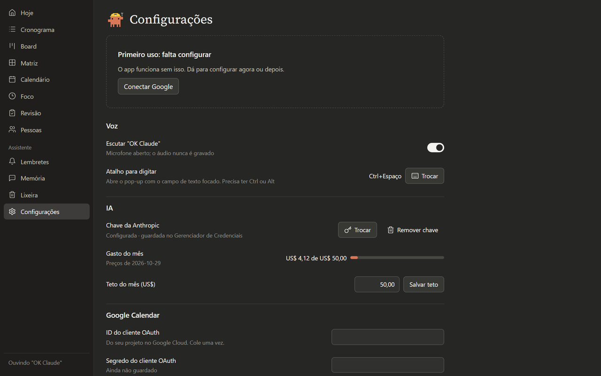 Settings: voice and shortcut, AI key, monthly spend and cap, and the Google Calendar connection.

### The AI assistant

A request reaches the pop-up by voice or text. The client talks to the Anthropic API using the Haiku model, with the fixed part of the prompt and the tools cached. Transcription is local, because the API does not accept audio.

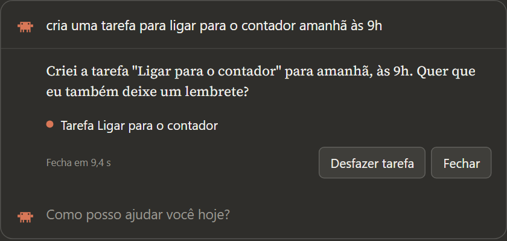 Assistant pop-up: a typed request, the answer, the action taken and the Undo button.

There are about 30 tools: tasks (create, update, complete, search, delete), events, people, reminders, schedule, weather, focus, calculator, memory, opening an app, folder or site, reading and searching files, and running a command. Each request makes at most 8 calls.

Limits and protections:

- The key sits in the Windows Credential Manager. Values that look like secrets are redacted before any log line is written.
- Ordinary writes run at once and can be undone. Deletions, guests and some Google writes wait for an OK on screen, by click or keyboard, never by voice.
- Once a conversation has read the web, a file or a third-party event, it is treated as tainted: opening things, writing to Google and saving memory ask for an OK until the pop-up closes.
- Executables and scripts go through the same command confirmation. Obfuscated commands are refused.
- Monthly spend has a configurable cap: a warning at 80% and a block at 100%.
- Product rule: the AI does not invent. The prompt requires anything from outside the app to come from a web search, cited with a link. If the search finds nothing, it says so. Text from pages and files is data, never instructions.

### Architecture

Tauri 2 with Rust at the core and React 19 with TypeScript in the interface. All data and rules live in the Rust process. The windows only draw and call commands. Each Rust module has its own domain, storage, commands and contract, and there are modules for voice, assistant, memory, PC actions and files.

Every write, from a screen, the AI, Google or the scheduler, emits the `data://changed` event, and open windows refresh what changed. An internal 30-second scheduler handles backup, sync, reminders and weather.

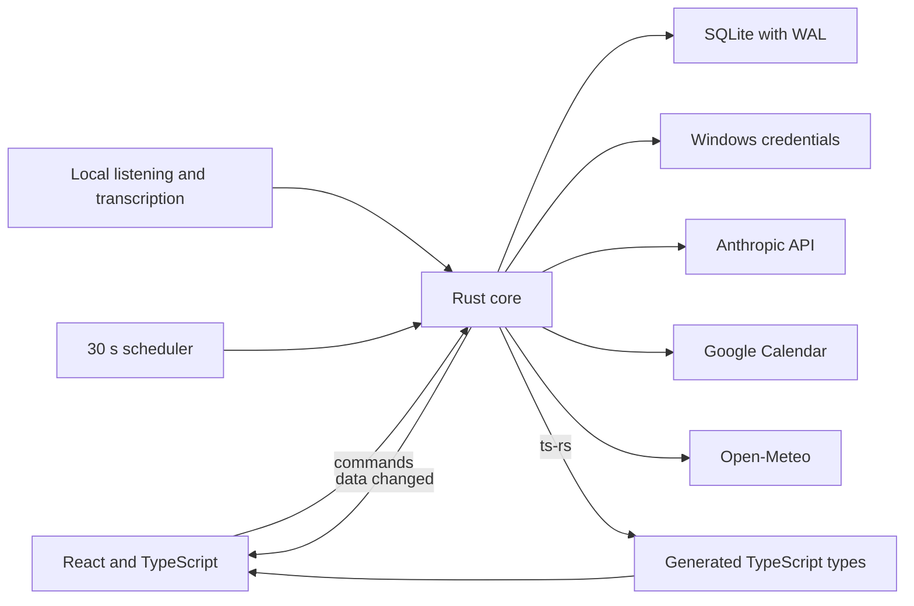

Data model, summarized by numbered migrations (16 so far): tasks, columns, labels, checklists and links to people; events, series and an outbox for Google; people; focus sessions and notes; schedule plans and blocks; day reviews; reminders; assistant conversations, messages, actions and usage; memory pages, versions, entities and links; settings and weather cache.

### Engineering decisions

1. **Tauri over Electron.** It uses the WebView2 already shipped with Windows, the installer is small and RAM use is lower. The cost is writing the native side in Rust.
2. **Generated contract.** Command types go from Rust to TypeScript, and a single contract suite runs against the real handler and against the fake `invoke` used by the front end. The front cannot drift from the back without a test failing.
3. **Security that does not rely on the AI obeying.** Confirmation lives in the core, and the tainted conversation rule holds even if the model is fooled by outside text.
4. **Data that survives accidents.** Numbered migrations with a database copy before applying, WAL, a local daily backup keeping the last 7, and opening the backup if the database is corrupted. Deletion is soft, with a Trash and a 30-day purge.
5. **UX from the start.** Every function is born with click, hover, keyboard focus and drag behavior, plus loading, empty, error, offline, success and undone states. Saving is automatic, with no unsaved-changes warning. Each screen has a MiniPRD listing its states, and a UX audit records what a person expects from each element.
6. **Undo that checks the version.** Each record carries a `version`. Undo refuses when something later changed the item, instead of overwriting it.

### How it was built

The project followed a fixed order: system design, visual design, a general PRD with IDs, one MiniPRD per screen, and only then code. It took 333 commits in 6 days, from 10/29 to 11/03/2026.

Work was split into waves, and each wave ran with AI subagents in isolated worktrees, one per front, each with a pending-items file where it records what it decided, what blocked it and what it asked. The product owner's decisions are dated and cited in the documents.

The gates are automatic:

- Git hooks block secrets, text outside the language convention and commits that change a test.
- Claude Code hooks lock any versioned test: a test that was written and seen failing does not change to let the implementation pass. An exception needs a reason, an approval and a commit trailer.
- A hook checks code patterns and duplicated symbols on every edit.
- Continuous integration runs on every branch: types, lint, formatting and front-end tests, Rust formatting, clippy and tests, and a check that the hooks still do what they say.

### Quality

On 11/05/2026, 1,031 TypeScript tests were passing. An earlier round recorded in the handover counted 862 front-end and 633 Rust tests. The functional smoke test with the fake core and Playwright, in light and dark themes, recorded 134 passing cases and 4 marked as pending on 11/03. There are accessibility tests and the single contract suite.

### What is left

- Installer without elevation, end-to-end tests on the packaged app and final performance measurement: not started.
- Voice is in the measurement phase: local listening and streaming transcription have runners ready, and the measurements with the user's voice are recorded as not yet run.
- Reminder tools and the memory and PC tools in the assistant, plus part of the Reminders and Memory screens, are being finished.
- Open items for calendar, trash and dashboard are tracked in their own files.
- Version 2, planned only: an MCP server for other agents on the PC, opening Claude Code sessions, repeating reminders, event series, an AI-planned week, dragging blocks, memory with semantic search.

Contact: <a href="https://joaocouto.alcetus.com">joaocouto.alcetus.com</a> · <a href="mailto:joaopecouto77@gmail.com">joaopecouto77@gmail.com</a>
