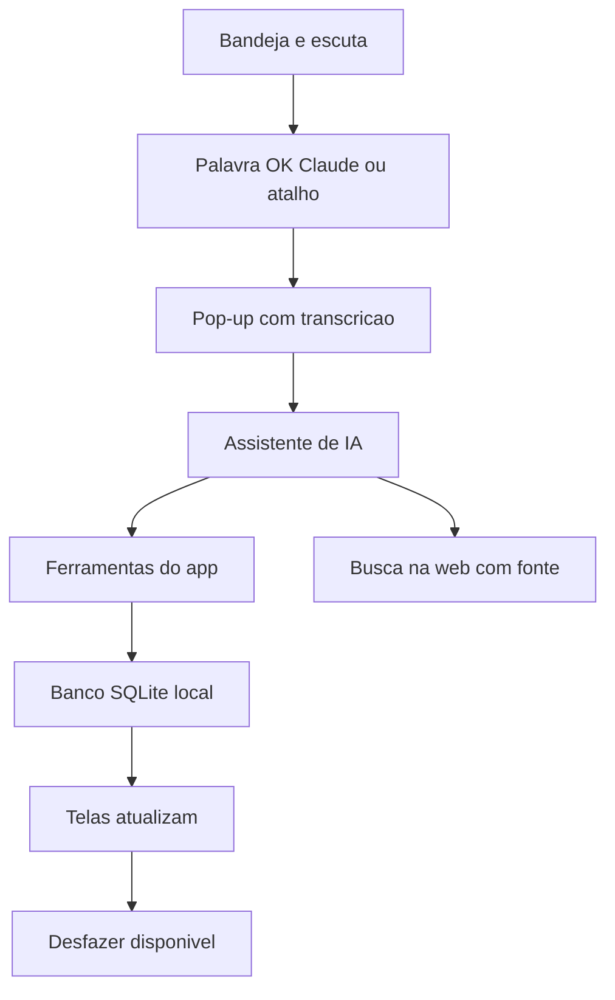
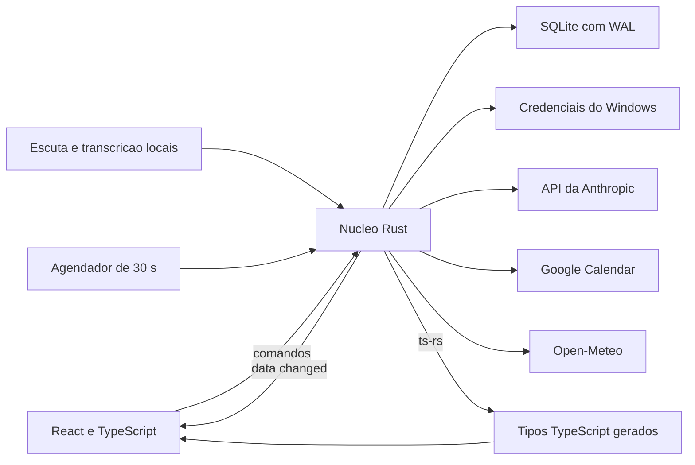
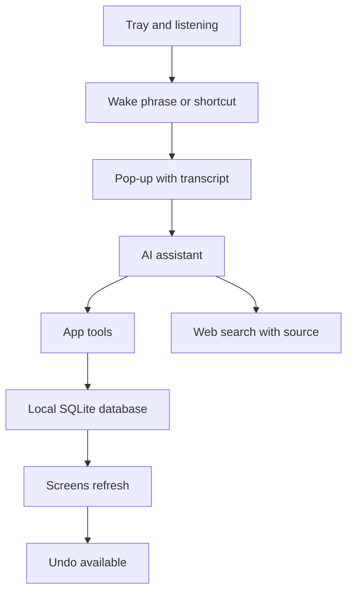
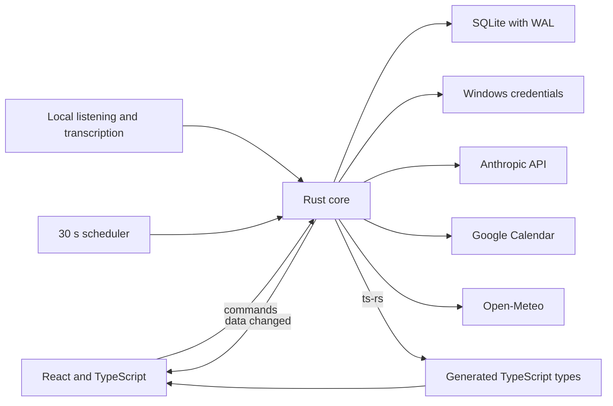

<h1 align="center">Ok, Claude</h1>

Agenda desktop com assistente de IA. <i>Desktop planner with an AI assistant.</i>

  <kbd> Tauri</kbd> <kbd> Rust</kbd> <kbd> React</kbd> <kbd> TypeScript</kbd> <kbd> SQLite</kbd> <kbd> Claude API</kbd>

<a href="#portugu%C3%AAs"><b>Português</b></a> &nbsp;|&nbsp; <a href="#english"><b>English</b></a>

> **PT** Projeto em desenvolvimento. O código é privado.
> **EN** Work in progress. The source code is private.

<table>
<tr>
<td width="50%"> Board · Kanban</td>
<td width="50%"> Matriz · Priority matrix</td>
</tr>
<tr>
<td width="50%"> Calendário · Calendar</td>
<td width="50%"> Cronograma · Daily schedule</td>
</tr>
</table>

Telas com dados de exemplo · Screens with sample data

## Português

<table>
<tr>
<td align="center" width="33%"><b>333</b> commits em 6 dias</td><td align="center" width="33%"><b>1.031</b> testes passando</td><td align="center" width="33%"><b>Rust + React</b> Tauri 2 e SQLite</td>
</tr>
</table>

### Visão geral

Ok, Claude é uma agenda pessoal para desktop Windows com um assistente que responde a voz ou texto. Ela reúne tarefas em Board e Matriz de prioridades, calendário sincronizado com o Google, cronograma do dia com previsão do tempo, sessões de foco, revisão do dia, cadastro de pessoas com aniversários, lembretes e uma memória de longo prazo. O assistente mexe nesses mesmos dados: cria tarefa, marca compromisso, abre uma pasta, faz uma conta ou pesquisa na web.

O app foi pensado para um usuário em um computador. Ele vive na bandeja do sistema, escuta a palavra de ativação "OK Claude" ou abre o pop-up por um atalho global, e funciona sem internet. Só a IA, o Google e o clima dependem de rede. Os dados ficam em um banco SQLite local, sem servidor e sem conta.

O código é privado. Este texto descreve o que o produto faz e como foi desenhado, a partir da documentação do projeto, que segue em desenvolvimento ativo. Cada tela e módulo abaixo traz o status registrado nos documentos.

### Como funciona

Um dia de uso:

1. O app sobe na bandeja quando o Windows inicia e começa a escutar a palavra de ativação.
2. De manhã, a tela Hoje mostra o resumo do dia, o clima e o bloco "Seu dia" do cronograma, montado com tarefas, eventos e rotina.
3. O usuário diz "OK Claude, me lembra às 14h de pesquisar X". O pop-up abre, mostra a transcrição enquanto ele fala e cria o lembrete, com botão Desfazer no rodapé.
4. No Board, arrasta um cartão para outra coluna. Um aviso oferece Desfazer, e Ctrl+Z também volta a ação.
5. Ao iniciar um bloco de Foco, o tempo restante aparece na bandeja. Ideias que surgem durante o bloco vão para "Anotado pra depois" e são decididas na triagem ao fim.
6. Às 14h, o lembrete toca com notificação do Windows e pop-up com OK e Adiar.
7. À noite, a Revisão fecha o dia: o que foi planejado, o que foi feito e o que fica para amanhã.

### Telas e módulos em detalhe

O andamento abaixo reflete a documentação do projeto em novembro de 2026.

#### Hoje (Dashboard)
Resumo do dia, próximo compromisso com link de reunião vindo do Google e clima. O resumo escrito pela IA fica guardado por dia, com botão para pedir outro, respeitando o teto de gasto. Status: em andamento.

#### Cronograma
Plano do dia em tela cheia, com rotina, tarefas, eventos e clima: atividade ao ar livre cai nas horas de sol. Sem a IA, o dia é montado só pela matriz e pelos eventos. Status da tela: concluído. Arrastar blocos e a semana planejada pela IA são da v2.

#### Board (Kanban)
Colunas, cartões com checklist, importância e primeiro passo, filtros, arraste por mouse ou teclado. Arrastar para a coluna Feito conclui a tarefa. Cartões de aniversário nascem sozinhos. Status: concluído.

#### Matriz
Tarefas por urgência e importância. Status: concluído.

#### Calendário
Vistas Dia, Semana, Mês e Agenda, sincronização com o Google a cada 30 segundos, fila de escrita offline com selo "pendente" e diálogo para desconectar a conta. O app nunca apaga evento no Google: apagar aqui marca como ignorado e manda para a Lixeira. Vistas: concluído. Semana, detalhe e formulário de evento: em andamento.

#### Foco e triagem
Bloco com pausas curta e longa, tempo na bandeja e no título, bipe e notificação no fim. Foco: concluído. Triagem: em andamento.

#### Revisão
Fecha o dia e convida pelo Windows ao fim da rotina do jantar. Status: concluído.

#### Pessoas
Cadastro com aniversário e preferências. Status: concluído.

#### Lembretes
Núcleo, job de disparo, notificação do Windows e lista no pop-up com OK e Adiar existem no código. Status: em andamento.

#### Memória
Páginas gravadas pela IA, com fixar, esquecer, limite de 1 GB e busca por palavra. O núcleo e as tabelas existem. Status: em andamento. Busca por sentido com embeddings locais é da v2.

#### Lixeira
Exclusão lógica em todo módulo, restauração e purga automática após 30 dias. Status: em andamento.

#### Configurações
Chave da API, cidade, Google, atalho, iniciar com o Windows, restaurar backup e passo a passo de primeiro uso. Status: em andamento.

### O assistente de IA

O pedido chega por voz ou texto ao pop-up. O cliente fala com a API da Anthropic usando o modelo Haiku, com a parte fixa do prompt e as ferramentas em cache. A transcrição é local, porque a API não recebe áudio.

Há cerca de 30 ferramentas: tarefas (criar, atualizar, concluir, buscar, apagar), eventos, pessoas, lembretes, cronograma, clima, foco, calculadora, memória, abrir app, pasta ou site, ler e buscar arquivo, e rodar comando. Cada pedido faz no máximo 8 chamadas.

Limites e proteções:

- A chave fica no Gerenciador de Credenciais do Windows. Valores com cara de segredo são redigidos antes de qualquer linha de log.
- Escritas comuns rodam direto e têm Desfazer. Apagar, convidados e algumas escritas no Google esperam um OK na tela, por clique ou teclado, nunca por voz.
- Depois que a conversa leu web, arquivo ou evento de terceiro, ela é tratada como contaminada: abrir algo, escrever no Google e gravar memória passam a pedir OK até o pop-up fechar.
- Executáveis e scripts passam pela mesma confirmação de comando. Comando ofuscado é recusado.
- O gasto mensal tem teto configurável: aviso em 80%, bloqueio em 100%.
- Regra de produto: a IA não inventa. O prompt manda que informação de fora do app venha só de busca na web, citada com link. Se a busca não achar, ela diz que não achou. Texto vindo de páginas e arquivos é dado, nunca instrução.

### Arquitetura

Tauri 2 com Rust no núcleo e React 19 com TypeScript na interface. Todo dado e toda regra moram no processo Rust. As janelas só desenham e chamam comandos. Cada módulo do Rust tem domínio, armazenamento, comandos e contrato próprios, e há módulos para voz, assistente, memória, ações no PC e arquivos.

Toda escrita, venha da tela, da IA, do Google ou do agendador, emite o evento `data://changed`, e as janelas abertas atualizam o que mudou. Um agendador interno de 30 segundos cuida de backup, sincronização, lembretes e clima.

Modelo de dados, resumido por migrações numeradas (hoje 16): tarefas, colunas, etiquetas, checklist e vínculos com pessoas; eventos, séries e fila de saída para o Google; pessoas; sessões e notas de foco; planos e blocos do cronograma; revisões do dia; lembretes; conversas, mensagens, ações e uso do assistente; páginas, versões, entidades e ligações da memória; configurações e cache de clima.

### Decisões de engenharia

1. **Tauri em vez de Electron.** Usa o WebView2 que já vem no Windows, o instalador é pequeno e a RAM menor. O custo é escrever a parte nativa em Rust.
2. **Contrato gerado.** Os tipos dos comandos saem do Rust para TypeScript, e uma única suíte de contrato roda contra o handler real e contra o falso do `invoke` usado no front. O front não diverge do back sem um teste falhar.
3. **Segurança que não depende de a IA obedecer.** A confirmação mora no núcleo, e a regra da conversa contaminada vale mesmo que o modelo seja enganado por um texto de fora.
4. **Dados à prova de acidente.** Migrações numeradas com cópia do banco antes de aplicar, WAL, backup diário local com os 7 últimos e abertura do backup se o banco estiver corrompido. Exclusão é lógica, com Lixeira e purga em 30 dias.
5. **UX desde o princípio.** Toda função nasce com clique, hover, foco por teclado e arraste, mais os estados de carregando, vazio, erro, sem internet, sucesso e desfeito. O salvamento é automático, sem aviso de sair sem salvar. Cada tela tem um MiniPRD com seus estados, e uma auditoria de UX registra o que a pessoa espera de cada elemento.
6. **Desfazer que confere versão.** Cada registro tem `version`. Desfazer recusa quando algo posterior mudou o item, em vez de sobrescrever.

### Como foi construído

O projeto seguiu uma ordem fixa: system design, design visual, PRD geral com IDs, um MiniPRD por tela, e só então código. Foram 333 commits em 6 dias, de 29/10 a 03/11/2026.

O trabalho foi dividido em ondas, e cada onda rodou com subagentes de IA em worktrees isolados, um por frente, cada um com um arquivo de pendências onde registra o que decidiu, o que travou e o que perguntou. As decisões do dono do produto são datadas e citadas nos documentos.

Os portões são automáticos:

- Hooks de git barram segredo, texto fora do padrão de idioma e commit com teste alterado.
- Hooks do Claude Code travam teste já versionado: um teste escrito e visto falhando não muda para a implementação passar. A exceção exige motivo, aprovação e um trailer no commit.
- Um hook confere padrões de código e símbolo duplicado a cada edição.
- A integração contínua roda em toda branch: tipos, lint, formatação e testes do front, formatação, clippy e testes do Rust, e uma checagem de que os hooks ainda fazem o que dizem.

### Qualidade

Em 05/11/2026, 1.031 testes TypeScript passavam. Uma rodada anterior registrada na retomada contava 862 de front e 633 de Rust. O teste de fumaça funcional com o núcleo falso e Playwright, nos temas claro e escuro, registrou 134 casos passando e 4 marcados como pendentes em 03/11. Há testes de acessibilidade e a suíte de contrato única.

### O que falta

- Instalador sem elevação, testes de ponta a ponta no app empacotado e medição final de desempenho: não iniciados.
- Voz em fase de medição: a escuta local e a transcrição em streaming têm runners prontos, e as medições com a voz do usuário constam como não rodadas.
- Ferramentas de lembrete e das ondas de memória e PC no assistente, e parte das telas de Lembretes e Memória, em acabamento.
- Pendências abertas de calendário, lixeira e dashboard estão listadas em arquivos próprios.
- Versão 2, só planejada: servidor MCP para outros agentes do PC, abrir sessões do Claude Code, lembretes que se repetem, séries de eventos, cronograma da semana pela IA, arrastar blocos, memória com busca por sentido.

## English

<table>
<tr>
<td align="center" width="33%"><b>333</b> commits in 6 days</td><td align="center" width="33%"><b>1,031</b> passing tests</td><td align="center" width="33%"><b>Rust + React</b> Tauri 2 and SQLite</td>
</tr>
</table>

### Overview

Ok, Claude is a personal agenda for Windows desktop with an assistant that answers to voice or text. It brings together tasks in a Board and a priority Matrix, a calendar synced with Google, a daily schedule with weather, focus sessions, an end-of-day review, a people directory with birthdays, reminders and a long-term memory. The assistant works on the same data: it creates a task, books an event, opens a folder, does a calculation or searches the web.

The app is designed for one user on one computer. It lives in the system tray, listens for the wake phrase "OK Claude" or opens its pop-up with a global shortcut, and works offline. Only the AI, Google and weather need a network. Data lives in a local SQLite database, with no server and no account.

The code is private. This text describes what the product does and how it was designed, drawn from the project documentation, and the project is under active development. Each screen and module below carries the status recorded in the documents.

### How it works

A day of use:

1. The app starts in the tray when Windows boots and begins listening for the wake phrase.
2. In the morning, the Today screen shows the day summary, the weather and the "Your day" schedule block, built from tasks, events and routine.
3. The user says "OK Claude, remind me at 2 pm to research X". The pop-up opens, shows the transcript while the user speaks and creates the reminder, with an Undo button in its footer.
4. On the Board, a card is dragged to another column. A toast offers Undo, and Ctrl+Z also reverts the action.
5. When a Focus block starts, the remaining time shows in the tray. Ideas that come up during the block go to "Noted for later" and are sorted in a triage at the end.
6. At 2 pm the reminder rings with a Windows notification and a pop-up with OK and Snooze.
7. In the evening, the Review closes the day: what was planned, what was done and what moves to tomorrow.

### Screens and modules in detail

Progress below reflects the project documentation as of November 2026.

#### Today (Dashboard)
Day summary, next appointment with a meeting link taken from Google, and weather. The AI-written summary is stored per day, with a button to ask for a new one, within the spending cap. Status: in progress.

#### Schedule
Full-screen daily plan with routine, tasks, events and weather: outdoor activities land in the sunny hours. Without the AI, the day is built from the matrix and the events alone. Screen status: done. Dragging blocks and the AI-planned week belong to v2.

#### Board (Kanban)
Columns, cards with checklist, importance and first step, filters, drag by mouse or keyboard. Dragging to the Done column completes the task. Birthday cards are created automatically. Status: done.

#### Matrix
Tasks by urgency and importance. Status: done.

#### Calendar
Day, Week, Month and Agenda views, Google sync every 30 seconds, an offline write queue with a "pending" badge and a dialog to disconnect the account. The app never deletes an event on Google: deleting here marks it as ignored and sends it to the Trash. Views: done. Week, detail and event form: in progress.

#### Focus and triage
Blocks with short and long breaks, time in the tray and window title, a beep and a notification at the end. Focus: done. Triage: in progress.

#### Review
Closes the day and invites the user through Windows at the end of the dinner routine. Status: done.

#### People
Directory with birthdays and preferences. Status: done.

#### Reminders
Core, firing job, Windows notification and a pop-up list with OK and Snooze exist in the code. Status: in progress.

#### Memory
Pages written by the AI, with pin, forget, a 1 GB limit and keyword search. The core and tables exist. Status: in progress. Semantic search with local embeddings belongs to v2.

#### Trash
Soft delete in every module, restore and automatic purge after 30 days. Status: in progress.

#### Settings
API key, city, Google, shortcut, start with Windows, backup restore and a first-use walkthrough. Status: in progress.

### The AI assistant

A request reaches the pop-up by voice or text. The client talks to the Anthropic API using the Haiku model, with the fixed part of the prompt and the tools cached. Transcription is local, because the API does not accept audio.

There are about 30 tools: tasks (create, update, complete, search, delete), events, people, reminders, schedule, weather, focus, calculator, memory, opening an app, folder or site, reading and searching files, and running a command. Each request makes at most 8 calls.

Limits and protections:

- The key sits in the Windows Credential Manager. Values that look like secrets are redacted before any log line is written.
- Ordinary writes run at once and can be undone. Deletions, guests and some Google writes wait for an OK on screen, by click or keyboard, never by voice.
- Once a conversation has read the web, a file or a third-party event, it is treated as tainted: opening things, writing to Google and saving memory ask for an OK until the pop-up closes.
- Executables and scripts go through the same command confirmation. Obfuscated commands are refused.
- Monthly spend has a configurable cap: a warning at 80% and a block at 100%.
- Product rule: the AI does not invent. The prompt requires anything from outside the app to come from a web search, cited with a link. If the search finds nothing, it says so. Text from pages and files is data, never instructions.

### Architecture

Tauri 2 with Rust at the core and React 19 with TypeScript in the interface. All data and rules live in the Rust process. The windows only draw and call commands. Each Rust module has its own domain, storage, commands and contract, and there are modules for voice, assistant, memory, PC actions and files.

Every write, from a screen, the AI, Google or the scheduler, emits the `data://changed` event, and open windows refresh what changed. An internal 30-second scheduler handles backup, sync, reminders and weather.

Data model, summarized by numbered migrations (16 so far): tasks, columns, labels, checklists and links to people; events, series and an outbox for Google; people; focus sessions and notes; schedule plans and blocks; day reviews; reminders; assistant conversations, messages, actions and usage; memory pages, versions, entities and links; settings and weather cache.

### Engineering decisions

1. **Tauri over Electron.** It uses the WebView2 already shipped with Windows, the installer is small and RAM use is lower. The cost is writing the native side in Rust.
2. **Generated contract.** Command types go from Rust to TypeScript, and a single contract suite runs against the real handler and against the fake `invoke` used by the front end. The front cannot drift from the back without a test failing.
3. **Security that does not rely on the AI obeying.** Confirmation lives in the core, and the tainted conversation rule holds even if the model is fooled by outside text.
4. **Data that survives accidents.** Numbered migrations with a database copy before applying, WAL, a local daily backup keeping the last 7, and opening the backup if the database is corrupted. Deletion is soft, with a Trash and a 30-day purge.
5. **UX from the start.** Every function is born with click, hover, keyboard focus and drag behavior, plus loading, empty, error, offline, success and undone states. Saving is automatic, with no unsaved-changes warning. Each screen has a MiniPRD listing its states, and a UX audit records what a person expects from each element.
6. **Undo that checks the version.** Each record carries a `version`. Undo refuses when something later changed the item, instead of overwriting it.

### How it was built

The project followed a fixed order: system design, visual design, a general PRD with IDs, one MiniPRD per screen, and only then code. It took 333 commits in 6 days, from 10/29 to 11/03/2026.

Work was split into waves, and each wave ran with AI subagents in isolated worktrees, one per front, each with a pending-items file where it records what it decided, what blocked it and what it asked. The product owner's decisions are dated and cited in the documents.

The gates are automatic:

- Git hooks block secrets, text outside the language convention and commits that change a test.
- Claude Code hooks lock any versioned test: a test that was written and seen failing does not change to let the implementation pass. An exception needs a reason, an approval and a commit trailer.
- A hook checks code patterns and duplicated symbols on every edit.
- Continuous integration runs on every branch: types, lint, formatting and front-end tests, Rust formatting, clippy and tests, and a check that the hooks still do what they say.

### Quality

On 11/05/2026, 1,031 TypeScript tests were passing. An earlier round recorded in the handover counted 862 front-end and 633 Rust tests. The functional smoke test with the fake core and Playwright, in light and dark themes, recorded 134 passing cases and 4 marked as pending on 11/03. There are accessibility tests and the single contract suite.

### What is left

- Installer without elevation, end-to-end tests on the packaged app and final performance measurement: not started.
- Voice is in the measurement phase: local listening and streaming transcription have runners ready, and the measurements with the user's voice are recorded as not yet run.
- Reminder tools and the memory and PC tools in the assistant, plus part of the Reminders and Memory screens, are being finished.
- Open items for calendar, trash and dashboard are tracked in their own files.
- Version 2, planned only: an MCP server for other agents on the PC, opening Claude Code sessions, repeating reminders, event series, an AI-planned week, dragging blocks, memory with semantic search.

Contato · Contact: <a href="https://joaocouto.alcetus.com">joaocouto.alcetus.com</a> · <a href="mailto:joaopecouto77@gmail.com">joaopecouto77@gmail.com</a>
