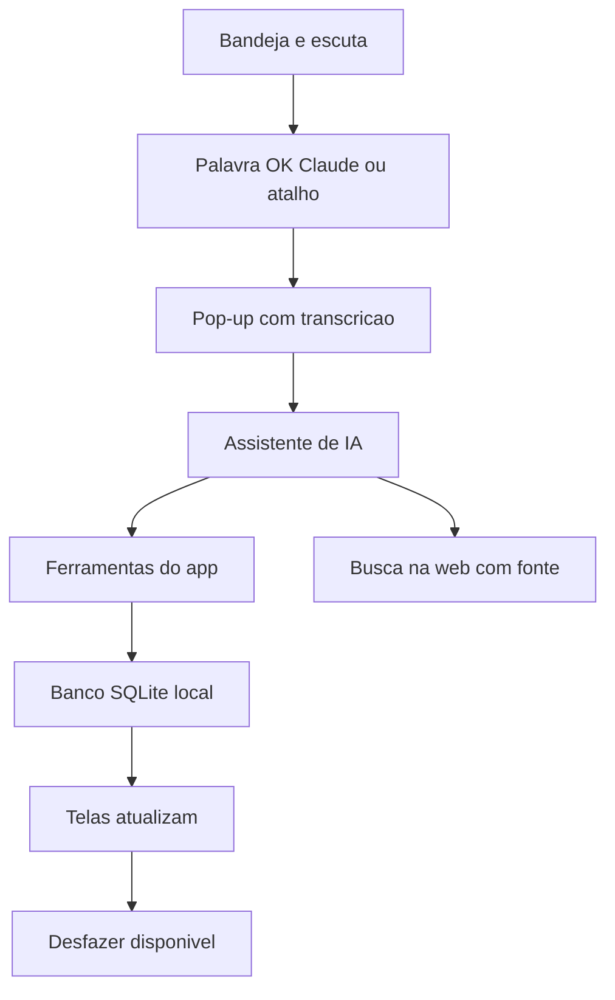
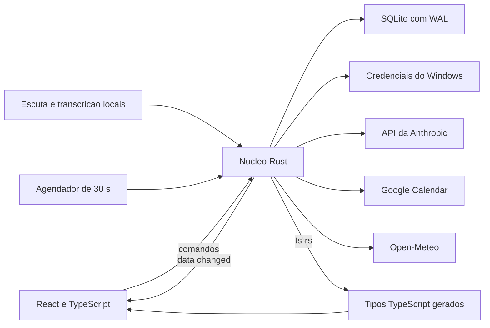

<h1 align="center">Ok, Claude</h1>

Agenda desktop com assistente de IA.

  <kbd>&nbsp;&nbsp; Tauri&nbsp;&nbsp;</kbd> &nbsp;<kbd>&nbsp;&nbsp; Rust&nbsp;&nbsp;</kbd> &nbsp;<kbd>&nbsp;&nbsp; React&nbsp;&nbsp;</kbd> &nbsp;<kbd>&nbsp;&nbsp; TypeScript&nbsp;&nbsp;</kbd> &nbsp;<kbd>&nbsp;&nbsp; SQLite&nbsp;&nbsp;</kbd> &nbsp;<kbd>&nbsp;&nbsp; Claude API&nbsp;&nbsp;</kbd>

 &nbsp; 

> Projeto em desenvolvimento. O código é privado.

<table>
<tr>
<td align="center" width="33%"><b>333</b> commits em 6 dias</td><td align="center" width="33%"><b>1.031</b> testes passando</td><td align="center" width="33%"><b>Rust + React</b> Tauri 2 e SQLite</td>
</tr>
</table>

### Visão geral

Ok, Claude é uma agenda pessoal para desktop Windows com um assistente que responde a voz ou texto. Ela reúne as tarefas em Board e Matriz de prioridades, calendário sincronizado com o Google, cronograma do dia com previsão do tempo, sessões de foco, revisão do dia, cadastro de pessoas com aniversários, lembretes e uma memória de longo prazo. O assistente mexe nesses mesmos dados: cria tarefa, marca compromisso, abre uma pasta, faz uma conta ou pesquisa na web.

O app foi pensado para um usuário em um computador. Ele vive na bandeja do sistema, escuta a palavra de ativação "OK Claude" ou abre o pop-up por um atalho global, e funciona mesmo sem internet. Só a IA, o Google e o clima dependem de rede. Os dados ficam em um banco SQLite local, sem servidor e sem conta.

O código é privado. Este texto descreve o que o produto faz e como foi desenhado, a partir da documentação do projeto, que segue em desenvolvimento ativo. Cada tela e módulo abaixo traz o status registrado nos documentos.

### Como funciona

Um dia de uso, do começo ao fim:

1. O app sobe na bandeja quando o Windows inicia e começa a escutar a palavra de ativação.
2. De manhã, a tela Hoje mostra o resumo do dia, o clima e o bloco "Seu dia" do cronograma, montado com tarefas, eventos e rotina.
3. O usuário diz "OK Claude, me lembra às 14h de pesquisar X". O pop-up abre, mostra a transcrição enquanto ele fala e cria o lembrete, com botão Desfazer no rodapé.
4. No Board, arrasta um cartão para outra coluna. Um aviso oferece Desfazer, e Ctrl+Z também volta a ação.
5. Ao iniciar um bloco de Foco, o tempo restante aparece na bandeja. Ideias que surgem durante o bloco vão para "Anotado pra depois" e são decididas na triagem ao fim.
6. Às 14h, o lembrete toca com notificação do Windows e pop-up com OK e Adiar.
7. À noite, a Revisão fecha o dia: o que foi planejado, o que foi feito e o que fica para amanhã.

### Telas e módulos em detalhe

O andamento abaixo reflete a documentação do projeto em novembro de 2026.

#### Hoje (Dashboard)
A tela mostra o resumo do dia, o próximo compromisso com o link da reunião vindo do Google e o clima. O resumo escrito pela IA fica guardado por dia, com botão para pedir outro, respeitando o teto de gasto. Ela está em andamento.

 Tela Hoje: resumo do dia escrito pela IA, blocos do plano, clima, aniversário e foco do dia.

#### Cronograma
O cronograma mostra o plano do dia em tela cheia, com rotina, tarefas, eventos e clima: atividade ao ar livre cai nas horas de sol. Sem a IA, o dia é montado só pela matriz e pelos eventos. A tela está concluída. Arrastar blocos e a semana planejada pela IA ficam para a v2.

 Cronograma do dia gerado pela IA, com horários, eventos e tarefas e o progresso de blocos feitos.

#### Board (Kanban)
O Board tem colunas, cartões com checklist, importância e primeiro passo, filtros e arraste por mouse ou teclado. Arrastar para a coluna Feito conclui a tarefa, e os cartões de aniversário nascem sozinhos. Ele está concluído.

 Board em colunas (Backlog, A fazer, Fazendo, Feito), com áreas coloridas, prazos e o cartão de aniversário.

#### Matriz
A Matriz organiza as tarefas por urgência e importância. Está concluída.

 Matriz de prioridade: importância contra prazo, com os quatro quadrantes e as áreas em cores.

#### Calendário
O Calendário tem as vistas Dia, Semana, Mês e Agenda e sincroniza com o Google a cada 30 segundos. Uma fila de escrita offline guarda o que foi gravado sem rede, com o selo "pendente", e um diálogo permite desconectar a conta. O app nunca apaga evento no Google: apagar aqui marca como ignorado e manda para a Lixeira. As vistas estão concluídas, e a semana, o detalhe e o formulário de evento estão em andamento.

 Calendário em visão semanal, com a mini-agenda lateral, a lista de agendas e os eventos do dia.

#### Foco e triagem
O Foco roda blocos com pausas curta e longa, mostra o tempo na bandeja e no título e avisa o fim com bipe e notificação. O foco está concluído, e a triagem está em andamento.

 Foco em andamento sobre uma tarefa, com o cronômetro, o checklist de preparo e as ideias anotadas para depois.

#### Revisão
A Revisão fecha o dia e convida pelo Windows ao fim da rotina do jantar. Está concluída.

 Revisão do dia: planejado contra feito, o que ficou por fazer e a nota de foco do dia.

#### Pessoas
O cadastro guarda o aniversário e as preferências de cada pessoa. Está concluído.

 Lista de pessoas com relação, aniversário e anotações; o aniversário próximo aparece em destaque.

#### Lembretes
O núcleo, o job de disparo, a notificação do Windows e a lista no pop-up com OK e Adiar já existem no código. A tela está em andamento.

 Lembretes agendados, com OK, Adiar 10 min e Cancelar em cada linha, e a origem (tela ou voz).

#### Memória
A memória guarda páginas gravadas pela IA, com fixar, esquecer, limite de 1 GB e busca por palavra. O núcleo e as tabelas existem, e a tela está em andamento. A busca por sentido com embeddings locais fica para a v2.

 Memória do assistente: fatos, procedimentos e episódios, com fixar, editar, apagar e o medidor de uso.

#### Lixeira
A exclusão é lógica em todo módulo, com restauração e purga automática após 30 dias. A Lixeira está em andamento.

 Lixeira com restauração em 30 dias: tarefas, eventos, pessoas, lembretes e páginas de memória apagados.

#### Configurações
As Configurações reúnem a chave da API, a cidade, o Google, o atalho, o iniciar com o Windows, a restauração de backup e o passo a passo de primeiro uso. Elas estão em andamento.

 Configurações: voz e atalho, chave da IA, gasto do mês e teto, e a conexão com o Google Calendar.

### O assistente de IA

O pedido chega por voz ou texto ao pop-up. O cliente fala com a API da Anthropic usando o modelo Haiku, com a parte fixa do prompt e as ferramentas em cache. A transcrição é local, porque a API não recebe áudio.

 Pop-up do assistente: um pedido digitado, a resposta, a ação feita e o botão Desfazer.

Há cerca de 30 ferramentas: tarefas (criar, atualizar, concluir, buscar, apagar), eventos, pessoas, lembretes, cronograma, clima, foco, calculadora, memória, abrir app, pasta ou site, ler e buscar arquivo, e rodar comando. Cada pedido faz no máximo 8 chamadas.

Limites e proteções:

- A chave fica no Gerenciador de Credenciais do Windows. Valores com cara de segredo são redigidos antes de qualquer linha de log.
- Escritas comuns rodam direto e têm Desfazer. Apagar, convidados e algumas escritas no Google esperam um OK na tela, por clique ou teclado, nunca por voz.
- Depois que a conversa leu web, arquivo ou evento de terceiro, ela é tratada como contaminada: abrir algo, escrever no Google e gravar memória passam a pedir OK até o pop-up fechar.
- Executáveis e scripts passam pela mesma confirmação de comando. Comando ofuscado é recusado.
- O gasto mensal tem teto configurável: aviso em 80%, bloqueio em 100%.
- Regra de produto: a IA não inventa. O prompt manda que informação de fora do app venha só de busca na web, citada com link. Se a busca não achar, ela diz que não achou. Texto vindo de páginas e arquivos é dado, nunca instrução.

### Arquitetura

Tauri 2 com Rust no núcleo e React 19 com TypeScript na interface. Todo dado e toda regra moram no processo Rust. As janelas só desenham e chamam comandos. Cada módulo do Rust tem domínio, armazenamento, comandos e contrato próprios, e há módulos para voz, assistente, memória, ações no PC e arquivos.

Toda escrita, venha da tela, da IA, do Google ou do agendador, emite o evento `data://changed`, e as janelas abertas atualizam o que mudou. Um agendador interno de 30 segundos cuida de backup, sincronização, lembretes e clima.

O modelo de dados, resumido por migrações numeradas (hoje 16), cobre: tarefas, colunas, etiquetas, checklist e vínculos com pessoas; eventos, séries e fila de saída para o Google; pessoas; sessões e notas de foco; planos e blocos do cronograma; revisões do dia; lembretes; conversas, mensagens, ações e uso do assistente; páginas, versões, entidades e ligações da memória; configurações e cache de clima.

### Decisões de engenharia

1. **Tauri em vez de Electron.** Usa o WebView2 que já vem no Windows, o instalador é pequeno e a RAM menor. O custo é escrever a parte nativa em Rust.
2. **Contrato gerado.** Os tipos dos comandos saem do Rust para TypeScript, e uma única suíte de contrato roda contra o handler real e contra o falso do `invoke` usado no front. O front não diverge do back sem um teste falhar.
3. **Segurança que não depende de a IA obedecer.** A confirmação mora no núcleo, e a regra da conversa contaminada vale mesmo que o modelo seja enganado por um texto de fora.
4. **Dados à prova de acidente.** Migrações numeradas com cópia do banco antes de aplicar, WAL, backup diário local com os 7 últimos e abertura do backup se o banco estiver corrompido. Exclusão é lógica, com Lixeira e purga em 30 dias.
5. **UX desde o princípio.** Toda função nasce com clique, hover, foco por teclado e arraste, mais os estados de carregando, vazio, erro, sem internet, sucesso e desfeito. O salvamento é automático, sem aviso de sair sem salvar. Cada tela tem um MiniPRD com seus estados, e uma auditoria de UX registra o que a pessoa espera de cada elemento.
6. **Desfazer que confere versão.** Cada registro tem `version`. Desfazer recusa quando algo posterior mudou o item, em vez de sobrescrever.

### Como foi construído

O projeto seguiu uma ordem fixa: system design, design visual, PRD geral com IDs, um MiniPRD por tela, e só então código. Foram 333 commits em 6 dias, de 29/10 a 03/11/2026.

O trabalho foi dividido em ondas, e cada onda rodou com subagentes de IA em worktrees isolados, um por frente, cada um com um arquivo de pendências onde registra o que decidiu, o que travou e o que perguntou. As decisões do dono do produto são datadas e citadas nos documentos.

Os portões são automáticos:

- Hooks de git barram segredo, texto fora do padrão de idioma e commit com teste alterado.
- Hooks do Claude Code travam teste já versionado: um teste escrito e visto falhando não muda para a implementação passar. A exceção exige motivo, aprovação e um trailer no commit.
- Um hook confere padrões de código e símbolo duplicado a cada edição.
- A integração contínua roda em toda branch: tipos, lint, formatação e testes do front, formatação, clippy e testes do Rust, e uma checagem de que os hooks ainda fazem o que dizem.

### Qualidade

Em 05/11/2026, 1.031 testes TypeScript passavam. Uma rodada anterior registrada na retomada contava 862 de front e 633 de Rust. O teste de fumaça funcional com o núcleo falso e Playwright, nos temas claro e escuro, registrou 134 casos passando e 4 marcados como pendentes em 03/11. Há testes de acessibilidade e a suíte de contrato única.

### O que falta

- O instalador sem elevação, os testes de ponta a ponta no app empacotado e a medição final de desempenho ainda não foram iniciados.
- A voz está em fase de medição: a escuta local e a transcrição em streaming têm runners prontos, e as medições com a voz do usuário constam como não rodadas.
- As ferramentas de lembrete e das ondas de memória e PC no assistente, e parte das telas de Lembretes e Memória, estão em acabamento.
- As pendências abertas de calendário, lixeira e dashboard estão listadas em arquivos próprios.
- A versão 2 está só planejada e prevê um servidor MCP para outros agentes do PC, a abertura de sessões do Claude Code, lembretes que se repetem, séries de eventos, o cronograma da semana pela IA, o arraste de blocos e a memória com busca por sentido.

Contato: <a href="https://joaocouto.alcetus.com">joaocouto.alcetus.com</a> · <a href="mailto:joaopecouto77@gmail.com">joaopecouto77@gmail.com</a>
