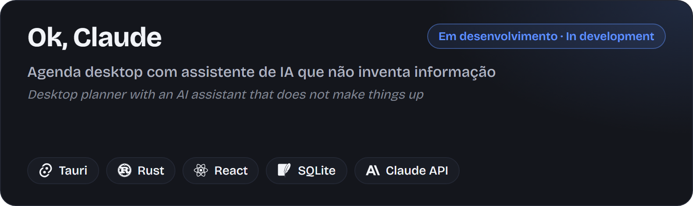

  

> **PT** Case study de um projeto em desenvolvimento. O código é privado.
> **EN** Case study of a work in progress. The source code is private.

## Português

### O que é

Agenda desktop para Windows, de uso pessoal, com um módulo de assistente que chama a **API da Anthropic**. A regra de produto para a IA: ela não inventa. Informação de fora do app só aparece com fonte e link.

### Decisões técnicas

- **Chave da API no Gerenciador de Credenciais do Windows**, nunca em arquivo; segredos passam por redação antes de qualquer log.
- **SQLite** com migrações numeradas e cópia antes de cada uma, modo WAL, backup diário e abertura do backup quando o banco corrompe.
- **Contrato único entre Rust e TypeScript:** os tipos dos comandos são gerados a partir do Rust, e uma só suíte de contrato vale para o backend real e para o falso do `invoke`.
- **Voz em fase de medição:** escuta local com palavra de ativação e transcrição em streaming estão sendo medidas (CPU, RAM, atraso, erro em português) antes de entrar no produto.

### Como foi construído

Desenvolvimento com **subagentes do Claude Code em worktrees isolados**, hooks de git, de testes e de padrões, e CI em toda branch. Foram **333 commits em 6 dias** (29/10 a 03/11/2026) e **1.031 testes** de TypeScript passando em 05/11/2026.

## English

### What it is

A personal desktop planner for Windows with an assistant module that calls the **Anthropic API**. The product rule for the AI: it does not make things up. Information from outside the app only appears with a source and a link.

### Technical decisions

- **API key in Windows Credential Manager**, never in a file; secrets are redacted before anything is logged.
- **SQLite** with numbered migrations and a copy taken before each one, WAL mode, a daily backup, and recovery from the backup when the database is corrupted.
- **A single contract between Rust and TypeScript:** command types are generated from Rust, and one contract suite covers both the real backend and the fake `invoke`.
- **Voice is being measured:** local wake-word listening and streaming transcription are under measurement (CPU, RAM, latency, Portuguese error rate) before they enter the product.

### How it was built

Built with **Claude Code subagents in isolated worktrees**, git, test and standards hooks, and CI on every branch. That came to **333 commits in 6 days** (2026-10-29 to 2026-11-03) and **1,031 TypeScript tests** passing on 2026-11-05.

[joaocouto.alcetus.com](https://joaocouto.alcetus.com) · [joaopecouto77@gmail.com](mailto:joaopecouto77@gmail.com)
